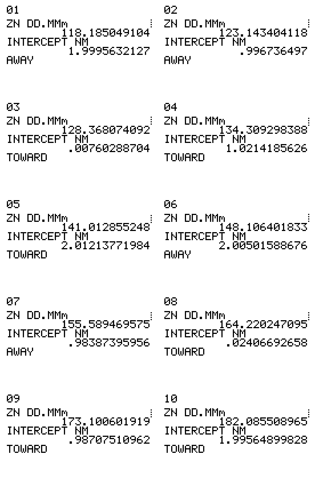

# Ten simulated Moon sights — October 11, 2026

All ten cases were run on the actual TI-85 ROM in TilEm: **SETUP first**, then MOON and SIGHT V8. Inputs were sent as calculator key presses; the saved result screens contain the calculator’s own output. The sextant readings are simulated, not observations of the sky.

## Observer and weather

- Approximate Grand Terrace / 92313 position: **34°02.0′ N, 117°18.8′ W**. This is a chosen representative position, not a surveyed location.
- SETUP: index correction 0′, eye height 2 m, **17°C**, **1002.71 hPa**.
- Weather: NWS **KRAL, Riverside Municipal**, observed **08:20 PDT / 15:20 UTC** on October 11: light rain. Pressure is the API’s reported `barometricPressure` field, converted from 100270.97 Pa. It is a nearby station input, not pressure measured at the observer’s precise location. [NWS observation](https://api.weather.gov/stations/KRAL/observations/latest); the retrieved response is preserved in [KRAL-weather.json](KRAL-weather.json).
- All cases used **artificial horizon**, so SIGHT halves the sextant angle and does not apply sea-horizon dip. Eye height is stored but unused in these cases.
- Times: **09:00–13:30 PDT / 16:00–20:30 UTC**, in 30-minute steps.

## Results

Hs is the doubled artificial-horizon sextant angle. Positive signed intercept is **toward**; negative is **away**. Azimuth Zn is clockwise from true north. Nominal targets were deliberately varied from 2 NM away to 2 NM toward; rounding Hs to 0.1′ accounts for the small differences from whole-number targets.

| Case | PDT | Limb | Hs | Hc | Zn | Native intercept | JPL-data reference intercept |
|---:|:---|:---|:---|---:|---:|:---|---:|
| 1 | 09:00 PDT | lower | 20°58.8′ | 11.6183° | 118.308° | 1.9996 NM away | -2.5231 NM |
| 2 | 09:30 PDT | upper | 32°13.7′ | 16.7232° | 123.239° | 0.9967 NM away | -1.3763 NM |
| 3 | 10:00 PDT | center | 41°22.9′ | 21.5252° | 128.613° | 0.0076 NM toward | -0.3524 NM |
| 4 | 10:30 PDT | lower | 49°48.0′ | 25.9533° | 134.515° | 1.0214 NM toward | +0.6492 NM |
| 5 | 11:00 PDT | upper | 58°50.2′ | 29.9173° | 141.021° | 2.0121 NM toward | +1.7081 NM |
| 6 | 11:30 PDT | center | 65°02.5′ | 33.3188° | 148.177° | 2.0050 NM away | -2.3391 NM |
| 7 | 12:00 PDT | lower | 70°03.7′ | 36.0461° | 155.982° | 0.9839 NM away | -1.4017 NM |
| 8 | 12:30 PDT | upper | 75°03.1′ | 37.9922° | 164.367° | 0.0241 NM toward | -0.2575 NM |
| 9 | 13:00 PDT | center | 76°44.3′ | 39.0666° | 173.168° | 0.9871 NM toward | +0.7168 NM |
| 10 | 13:30 PDT | lower | 76°32.8′ | 39.2098° | 182.143° | 1.9956 NM toward | +1.6037 NM |

## Checks and their limits

**Calculator arithmetic:** A separate Python calculation used the same MOON almanac inputs and the documented SIGHT V8 correction equation. It used an atan2 azimuth calculation, independently of the calculator’s azimuth quadrant branch. Every direction matched the expected sign. Maximum absolute residuals were:

- Ho: 4.97e-09 arcminute; Hc: 4.92e-09 arcminute.
- Zn: 3.42e-08 arcminute; intercept magnitude: 2.91e-10 NM.

This establishes agreement with the implemented equation and the entered data; it does not independently validate the atmospheric refraction model.

**Independent Moon ephemeris:** JPL Horizons DE441 was queried at all ten UTC times for geocentric, airless apparent right ascension/declination, angular diameter, and range. Apparent sidereal time was separately queried at longitude 0°; GHA = 15 × sidereal hours − apparent RA, modulo 360°. HP was derived from range using Earth equatorial radius 6378.14 km, and SD from half the angular diameter. The full JPL responses are saved alongside this report. [Horizons definitions](https://ssd.jpl.nasa.gov/horizons/manual.html#definition-of-observer-table-quantities).

Maximum absolute differences between the calculator’s MOON output and JPL:

- GHA: **0.298′**; declination: **0.172′**.
- HP: **0.206′**; SD: **0.073′**.
- Replacing only the Moon almanac inputs with JPL values, while retaining the same V8 correction equation and simulated Hs, changed the signed intercept by at most **0.524 NM**.

These are checks for this date, position, time range, and artificial-horizon branch. They do not establish accuracy for all dates or for sea-horizon sights.

**Half-hour interpolation:** SIGHT’s Nautical branch was used. Hourly GHA/declination came from MOON. For half-hour cases, effective signed v and d rates were derived from MOON’s hourly and half-hour endpoints so the interpolation reaches the calculated endpoint. These are not independently published Nautical Almanac v/d entries.

## Files and screens

- [CSV — all numerical results](results.csv)
- [JSON — results and exact entered values](results.json)
- [All ten final calculator screens](result-screens.png)
- [Saved SETUP screen](setup-complete.png)

Each case also has two MOON screens and three SIGHT screens, named `case-NN-moon-1.png` through `case-NN-sight-3.png`.

